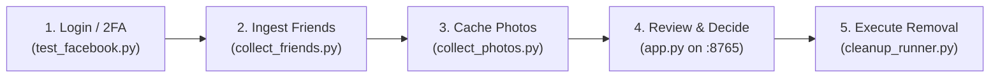
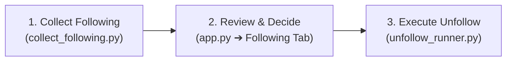
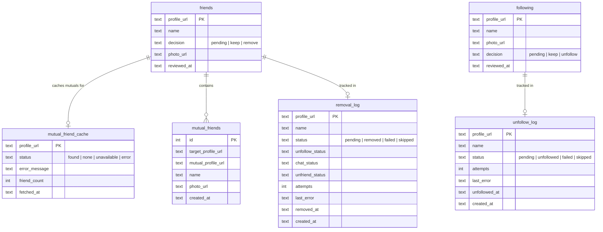

# FacebookCleanup

[](https://pypi.org/project/fb-friend-cleanup/)
[](https://pypi.org/project/fb-friend-cleanup/)
[](LICENSE)
[](https://github.com/ticonetster/fb-friend-cleanup/releases)

An automated, local toolkit to audit, review, and selectively clean up your Facebook friends list while preserving full control, decision history, and account safety.

Built with **Python**, **Flask**, **Playwright**, and **SQLite**.

---

## Table of Contents

- [Overview & Workflow Order](#overview--workflow-order)
- [Project Prerequisites & Setup](#project-prerequisites--setup)
- [Scripts Reference & Order of Use (Friends Cleanup)](#scripts-reference--order-of-use-friends-cleanup)
  - [Step 1: Session Authentication (`test_facebook.py`)](#step-1-session-authentication-test_facebookpy)
  - [Step 2: Collect Friends (`collect_friends.py`)](#step-2-collect-friends-collect_friendspy)
  - [Step 3: Collect Profile Photos (`collect_photos.py`)](#step-3-collect-profile-photos-collect_photospy)
  - [Step 4: Interactive Review Web App (`app.py`)](#step-4-interactive-review-web-app-apppy)
  - [Step 5: 3-in-1 Cleanup Execution (`cleanup_runner.py`)](#step-5-3-in-1-cleanup-execution-cleanup_runnerpy)
- [Following Cleanup Workflow (Accounts You Only Follow)](#following-cleanup-workflow-accounts-you-only-follow)
  - [Step 1: Collect Followed Accounts (`collect_following.py`)](#step-1-collect-followed-accounts-collect_followingpy)
  - [Step 2: Review in Web App (`app.py`)](#step-2-review-in-web-app-apppy)
  - [Step 3: Execute Unfollow Batch (`unfollow_runner.py`)](#step-3-execute-unfollow-batch-unfollow_runnerpy)
- [Database Architecture & Data Safety](#database-architecture--data-safety)
- [Facebook Anti-Abuse, Rate Limits & Best Practices](#facebook-anti-abuse-rate-limits--best-practices)
- [Troubleshooting & FAQ](#troubleshooting--faq)

---

## Overview & Workflow Order

The cleanup process follows a sequential 5-phase lifecycle:



1. **Authenticate**: Establish and persist a valid Facebook session in the local Playwright profile (`browser_profile/`).
2. **Collect**: Ingest visible friends from your Facebook friends list into SQLite.
3. **Enrich**: Cache thumbnail profile pictures so you can visually identify friends during review.
4. **Review**: Launch the local Flask app at `http://127.0.0.1:8765` to review each person one-by-one (KEEP / REMOVE / UNDO), with automatic background discovery of mutual friends.
5. **Clean**: Execute removals safely in controlled batches (3-in-1: Unfollow, Delete Chat, Unfriend).

---

## Project Prerequisites & Setup

### Environment Requirements
- **OS**: Windows, macOS, or Linux
- **Python**: 3.10+
- **Virtual Environment**: `.venv` in your project directory

### Installation & Setup Options

#### Option A: Install from PyPI (Recommended)
```bash
pip install fb-friend-cleanup
playwright install chromium
```
Once installed, you can launch the tools from any directory:
- `fb-cleanup-app` - Starts the local web review interface at `http://127.0.0.1:8765` (supports both Friends & Following)
- `fb-cleanup-runner` - Starts the automated 3-in-1 friend cleanup batch execution
- `fb-collect-following` - Ingests profiles and pages you follow from `facebook.com/me/following`
- `fb-unfollow-runner` - Safely unfollows accounts marked to unfollow

#### Option B: Install via pip from GitHub
```bash
pip install git+https://github.com/ticonetster/fb-friend-cleanup.git
playwright install chromium
```

#### Option C: Download Release Package (.whl)
Download `fb_friend_cleanup-1.0.0-py3-none-any.whl` from the [Latest GitHub Release](https://github.com/ticonetster/fb-friend-cleanup/releases/latest) and install:
```bash
pip install fb_friend_cleanup-1.0.0-py3-none-any.whl
playwright install chromium
```

#### Option D: Clone and Run from Source (Recommended for Local Customization)
```bash
# Clone the repository (or open your existing project folder)
git clone https://github.com/ticonetster/fb-friend-cleanup.git
cd fb-friend-cleanup

# Create and activate virtual environment
# Windows (PowerShell):
python -m venv .venv
.\.venv\Scripts\Activate.ps1

# macOS / Linux:
python3 -m venv .venv
source .venv/bin/activate

# Install package dependencies
pip install -e .

# Install Chromium browser binaries for Playwright
playwright install chromium
```

---

## Scripts Reference & Order of Use

### Step 1: Session Authentication (`test_facebook.py`)

- **Purpose**: Opens a visible Chromium window using the dedicated persistent profile folder (`browser_profile/`). Used to log in, solve 2FA prompts, and click "Remember browser".
- **When to run**:
  - Initial project setup.
  - Whenever Facebook logs you out or prompts for 2FA.
- **Usage**:
  ```bash
  python test_facebook.py
  ```
- **Instructions**:
  1. The browser will open to `https://www.facebook.com/`.
  2. Enter your email and password, complete any 2FA challenge, and select **"Save Browser / Remember Browser"**.
  3. Once on your Facebook feed, return to the terminal and press **Enter** to save the session and close the browser.

---

### Step 2: Collect Friends (`collect_friends.py`)

- **Purpose**: Navigates to `https://www.facebook.com/me/friends`, reads visible friend cards, normalizes profile URLs, and seeds the `friends` table in `friends.sqlite3` with `decision='pending'`.
- **When to run**: After logging in, to ingest your full Facebook friends list.
- **Usage**:
  ```bash
  python collect_friends.py
  ```
- **Instructions**:
  1. A browser window opens directly to your Facebook friends page.
  2. Manually scroll down through your friends list until all or most friends have loaded into the DOM.
  3. Return to the terminal and press **Enter**.
  4. The script filters system links, normalizes profile URLs to `https://www.facebook.com/<username>`, and inserts new records using `INSERT OR IGNORE`.

---

### Step 3: Collect Profile Photos (`collect_photos.py`)

- **Purpose**: Captures thumbnail avatar URLs from the friends list page and populates the `photo_url` column in `friends.sqlite3`.
- **When to run**: Immediately after collecting friends, before starting review.
- **Usage**:
  ```bash
  python collect_photos.py
  ```
- **Instructions**:
  1. The browser opens your friends list.
  2. Scroll through the page so friend thumbnail images are visibly rendered.
  3. Press **Enter** in the terminal.
  4. The script updates matching records in `friends` with their high-resolution or thumbnail CDN photo URL.

---

### Step 4: Interactive Review Web App (`app.py`)

- **Purpose**: Local web interface to review each candidate profile individually, make KEEP/REMOVE decisions, undo mistakes, and view mutual friends.
- **Features**:
  - **Zero Destructive Actions**: Only updates local review decisions (`keep` / `remove`). Does not modify Facebook relationships.
  - **Automatic Mutual-Friend Discovery**: Runs in a non-blocking background worker thread using the authenticated browser session. Distinguishes between:
    - **Found**: Lists mutual friends with avatars, names, and direct profile links.
    - **None**: Confirmed zero mutual friends.
    - **Unavailable**: Private / restricted friends list.
    - **Error**: Network or session error with an in-UI "Retry" button.
  - **Asynchronous UI**: KEEP and REMOVE buttons remain responsive instantly without waiting for mutual-friend lookups.
  - **Undo Support**: Reverts previous decisions seamlessly.
- **Usage**:
  ```bash
  python app.py
  # Or run the installed CLI command:
  fb-cleanup-app
  ```
- **Accessing the App**:
  - Open **`http://127.0.0.1:8765`** in your browser.
  - Review candidates until all profiles reach 100% completion.

---

### Step 5: 3-in-1 Cleanup Execution (`cleanup_runner.py`)

- **Purpose**: Automates the removal of profiles marked with `decision='remove'` in `friends.sqlite3`.
- **For each candidate, it performs 3 sequential actions**:
  1. **Unfollow**: Accesses profile options to unfollow, immediately clearing their posts from your Facebook feed.
  2. **Delete Chat**: Opens Messenger, accesses chat settings, and deletes the conversation history (or marks `no_chat` if no messages exist).
  3. **Unfriend**: Clicks the "Friends" menu, selects "Unfriend", and confirms the removal modal.

#### Safety Controls & Anti-Abuse Features
- **Batched Execution**: Configurable batch size (default: 30 profiles per run).
- **Human Pacing & Jitter**: Randomized delays between 10 and 22 seconds per profile, plus 30–45s micro-cooldowns every 10 actions.
- **Automated Checkpoint Detection**: Immediately halts if Facebook displays *"Please slow down"*, *"You're temporarily blocked"*, action blocks, or CAPTCHAs.
- **Persistent State Tracking**: Every operation is logged in the `removal_log` table with timestamps, individual step statuses (`unfollow_status`, `chat_status`, `unfriend_status`), and error messages.
- **Resumable**: If stopped or interrupted, re-running the script picks up exactly where it left off.

#### Commands & Flags

| Command | Purpose |
| :--- | :--- |
| `python cleanup_runner.py --single --dry-run` | **Dry Run**: Inspects 1 profile, checks buttons without clicking final confirm. |
| `python cleanup_runner.py --single` | **Live Single Test**: Performs live Unfollow, Chat deletion, and Unfriend on 1 profile. |
| `python cleanup_runner.py` | **Standard Batch**: Processes the next batch of **30** queued profiles with pacing. |
| `python cleanup_runner.py --batch-size 15` | Processes a smaller batch of 15 profiles. |
| `python cleanup_runner.py --delay-min 15 --delay-max 30` | Increases delays between actions for extra caution. |
| `python cleanup_runner.py --headless` | Runs browser in background headless mode (default is headed window). |

---

## Following Cleanup Workflow (Accounts You Only Follow)

If you follow creators, public figures, pages, or accounts that you are **not** friends with, you can audit and prune them using the dedicated Following workflow:



### Step 1: Collect Followed Accounts (`collect_following.py`)
- **Purpose**: Navigates to `https://www.facebook.com/me/following`, extracts visible profiles and pages with thumbnail avatars, normalizes profile URLs, and populates the `following` table.
- **Usage**:
  ```bash
  # Interactive mode: opens browser, scroll down to load accounts, then press Enter in terminal
  python collect_following.py

  # Automatic scrolling mode (scrolls down with jitter):
  python collect_following.py --auto-scroll --max-scrolls 30
  ```

### Step 2: Review in Web App (`app.py`)
- Launch the web app:
  ```bash
  python app.py
  # Or run: fb-cleanup-app
  ```
- Click the **"🔔 Following Review"** tab at the top of the interface.
- Review each followed profile/page:
  - **✓ KEEP FOLLOWING** (Press `K`): Remains followed.
  - **✕ UNFOLLOW** (Press `U` or `R`): Marks profile to be unfollowed.
  - **↶ Undo** (Press `Z`): Reverts your last decision.

### Step 3: Execute Unfollow Batch (`unfollow_runner.py`)
- **Purpose**: Automates the unfollow action on profiles marked with `decision='unfollow'`. Navigates to each profile header, clicks "Following", selects "Unfollow", and records progress in `unfollow_log`.
- **Usage**:
  ```bash
  # Test with a single profile in dry-run mode (doesn't click Unfollow)
  python unfollow_runner.py --single --dry-run

  # Live test on a single profile
  python unfollow_runner.py --single

  # Standard batch (processes next 30 queued accounts with human pacing & jitter)
  python unfollow_runner.py

  # Or using the installed CLI command:
  fb-unfollow-runner
  ```

---

## Database Architecture & Data Safety

All application data is maintained in SQLite at `friends.sqlite3`:



### Backups and Exports
- **`friends_backup_*.sqlite3`**: Full point-in-time SQLite backups.
- **`to_remove.csv`**: Exported CSV list of all profiles marked for removal.
- **`to_keep.csv`**: Exported CSV list of all profiles marked to keep.

---

## Facebook Anti-Abuse, Rate Limits & Best Practices

Facebook aggressively monitors account relationship changes. Adhere to these guidelines to keep your account safe:

1. **Avoid Bulk Rushing**: Do not attempt to remove hundreds of friends in a single hour.
2. **Pacing Recommendation**:
   - Limit to **1–2 batches of 30 profiles per day** (or 30–60 removals daily).
   - Allow natural gaps (several hours) between batches.
3. **If an Action Block Appears**:
   - If Facebook shows *"You're temporarily blocked from using this feature"*, **stop immediately**.
   - Do not test or attempt manual unfriends during a block.
   - Wait **24 full hours** for the automated rate limit to expire completely before resuming.

---

## Troubleshooting & FAQ

### Browser redirects to 2FA / "Remember Browser" on startup
- **Symptom**: `cleanup_runner.py` pauses or prompts for login.
- **Resolution**: A visible browser window will open. Click "Save Browser" or "Don't Save" on the Facebook prompt, then press **Enter** in your terminal to proceed.

### An individual profile fails with a timeout
- Facebook occasionally delays background media loading on certain heavy profiles.
- `cleanup_runner.py` catches these timeouts, logs the issue to `removal_log` with status `'failed'`, and continues with the rest of the batch.
- To retry failed profiles at any time, run:
  ```bash
  python -c "import cleanup_runner; db = cleanup_runner.connect(); db.execute('UPDATE removal_log SET status=\"pending\" WHERE status=\"failed\"'); db.commit(); print('Failed profiles reset to pending.')"
  ```

### How do I check current progress?
Run this one-liner to view remaining and completed counts:
```bash
python -c "import cleanup_runner; print(cleanup_runner.get_removal_stats())"
```

---

## License

This project is licensed under the **GNU General Public License v3.0** (GPLv3) - see the [LICENSE](LICENSE) file for full details.

### Disclaimer
This software is provided for personal data management and curation purposes. It is not affiliated with, authorized, maintained, or endorsed by Meta Platforms, Inc. Use responsibly and adhere to platform rate limits.

